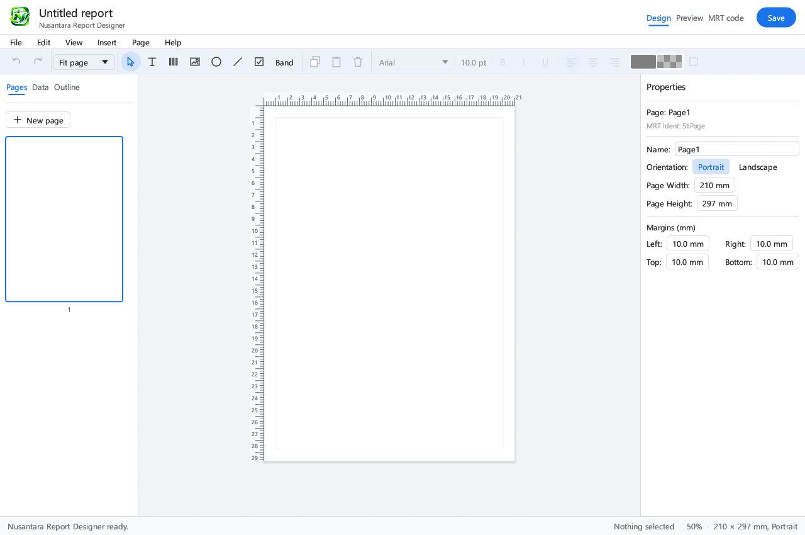

# Nusantara Report Designer

A desktop designer for `.mrt` report templates. Lay out bands and fields, preview with live data, and export to HTML or text.

[](LICENSE)




## Features

**Design**
- Page sizes A4, Letter, Legal, or custom. Portrait and landscape orientation.
- Bands: Report Title, Page Header, Header, Data, Footer, Page Footer, Report Summary.
- Components: text, barcode, image, shape, line, checkbox.
- Grid, snap to grid, rulers, zoom, and fit page.
- Text formatting: font, size, bold, italic, underline, alignment, text and fill colour, and per-side borders.
- Undo and redo, copy, paste, duplicate, and multiple pages.
- Outline view of bands and components.

**Rich text (HTML tags)**
- Text components can enable *Allow HTML tags*.
- Supported tags: `b`, `strong`, `i`, `em`, `u`, `font` (color, size, face), `span` (style), `br`, `p`, `div`, `sup`, `sub`, and entities such as `&nbsp;`.
- An HTML editor in the Properties panel with toolbar buttons for bold, italic, underline, colour, size, and line break, plus a source box and a live preview.

**Data and expressions**
- Load JSON data through the *Data* tab, or let the app pick up data files referenced by a `.mrt` (looked up in a local `assets/json` folder).
- Expressions: `{Source.Column}`, `{Variable}`, and `{Convert.ToDateTime(...).ToString("dd MMMM yyyy")}`.
- Expressions that are not supported are shown as written.

**Preview**
- All pages are shown with pagination. Data bands repeat per row and continue on the next page when needed.
- Page header and footer repeat on every page, with page number and total page count filled in.
- Export to HTML (absolute positioning per component) or to plain text.

**File formats**
- Reads `.mrt` files in JSON and XML formats.
- Units: centimetres, inches, millimetres, and hundredths of an inch. Everything is converted to millimetres internally.
- Saves `.mrt` in JSON format.

## Limitations

- Images (`StiImage`) and tables (`StiTable`) are not rendered yet. They appear as placeholders.
- Only one sans-serif font family is used (Segoe UI on Windows). Serif fonts such as Times New Roman are not supported.
- Charts, crosstabs, and RTF rich text are not supported.
- Saving overwrites the file that was opened. Use *Save as* when working on files in a shared or production folder.

## Installation

### Requirements

- Windows 10 or 11.
- Rust, stable toolchain, with support for the 2024 edition.
- The GNU toolchain (`x86_64-pc-windows-gnu`) with MinGW-w64 tools. The project uses `gcc`, `ar`, and `windres`. Install them with [MSYS2](https://www.msys2.org/) (package `mingw-w64-x86_64-toolchain`), or adjust the paths in [`.cargo/config.toml`](.cargo/config.toml).

### Build

Run these commands from the project root (the folder that contains `Cargo.toml`):

```powershell
cargo build              # debug build, keeps the console for logs
cargo build --release    # release build, no console, icon and version info embedded
```

Output:
- Debug: `target\debug\nusantara_report_designer.exe`
- Release: `target\release\nusantara_report_designer.exe`

The build number is stamped automatically and increases with each compile. It is stored in `build_number.txt`.

## Usage

```powershell
cargo run
```

Command-line options:

| Option | Description |
|---|---|
| `--open <file.mrt>` | Open a template on start |
| `--preview` | Start in Preview mode |
| `--about` | Open the About dialog on start |
| `--splash` | Show the splash screen even in screenshot mode |
| `--screenshot <file.png>` | Save a screenshot after about 120 frames and exit |

The splash screen appears for about two seconds on a normal start. Click it to close early.

### Keyboard shortcuts

| Shortcut | Action |
|---|---|
| Ctrl+N | New report |
| Ctrl+O | Open file |
| Ctrl+S | Save |
| Ctrl+Z / Ctrl+Y | Undo / redo |
| Ctrl+C / Ctrl+V | Copy / paste component |
| Ctrl+D | Duplicate component |
| Delete | Delete selected component or band |

## Development

### Tests

```powershell
cargo test
```

Some tests read sample files from disk. They run only when these environment variables are set:

```powershell
# Summary of every .mrt file in one folder
$env:NUSA_MRT_DIR = "C:\path\to\templates"
cargo test summarise_sample_folder -- --nocapture

# Summary of the data sources in one JSON file
$env:NUSA_DATA_FILE = "C:\path\to\data.json"
cargo test summarise_data_file -- --nocapture
```

### Project layout

```
.
├── Cargo.toml
├── build.rs              # build number, Windows icon and version resource
├── build_number.txt      # daily build counter
├── assets/               # application icon and logo (WebP)
├── docs/                 # documentation assets
├── .cargo/config.toml    # linker and PATH for the GNU toolchain
└── src/
    ├── main.rs           # command-line options and window setup
    ├── model/            # report, bands, components, .mrt parser,
    │                     # expressions, rich text
    └── ui/               # ribbon, side panel (Pages / Data / Outline),
                          # canvas, properties, HTML editor, preview,
                          # dialogs, About, splash
```

## Contributing

Contributions are welcome. Before opening a pull request:

1. Fork the repository and create a branch for your change.
2. Run `cargo build` and `cargo test`. Both must pass without warnings.
3. Keep changes focused. One feature or fix per pull request.
4. Describe what changed and how you tested it.

Bug reports and feature requests are welcome through the issue tracker. For bugs, include the steps to reproduce, the build number shown in the title bar, and, if possible, a small `.mrt` file that shows the problem.

## License

Nusantara Report Designer is free software: you can redistribute it and/or modify it under the terms of the **GNU General Public License version 3** (or, at your option, any later version). It is distributed in the hope that it will be useful, but **without any warranty**. See [LICENSE](LICENSE) for the full text.

Copyright © 2026.

## Acknowledgements

- [egui](https://github.com/emilk/egui) and [eframe](https://github.com/emilk/egui/tree/master/crates/eframe), the immediate-mode GUI and window framework.
- [serde](https://serde.rs/) and [serde_json](https://github.com/serde-rs/json), for reading and writing report files.
- [image](https://github.com/image-rs/image), for decoding the icon and logo.
- [rfd](https://github.com/PolyMeilex/rfd), for native file dialogs.
- [uuid](https://github.com/uuid-rs/uuid) and [chrono](https://github.com/chronotope/chrono).
